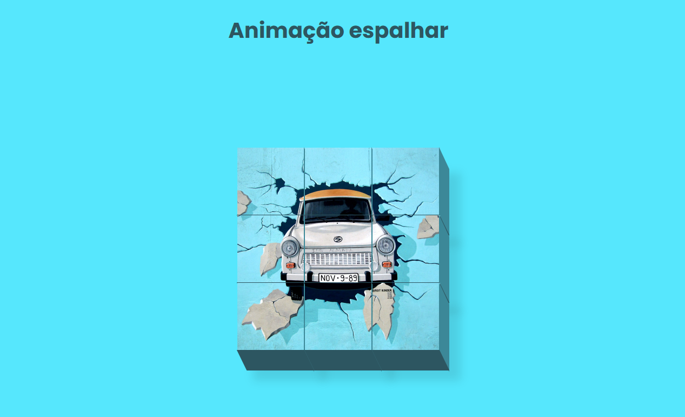

# 🧩 Animação de Quebra de Imagem

Projeto de uma animação interativa de fragmentação de imagem, desenvolvido com **HTML5 e CSS3** como parte de uma atividade prática de desenvolvimento Front-End.

O projeto tem como objetivo explorar animações e transformações CSS, criando um efeito visual no qual uma imagem dividida em nove fragmentos se espalha ao passar o cursor do mouse.

## 🖥️ Prévia do projeto

  

🔗 **[Acesse o projeto online](https://gabrielc0liveira.github.io/Projeto16-AnimacaoQuebraImagem/)**

## Funcionalidades e características

- Imagem composta por nove fragmentos organizados em uma grade 3x3.
- Animação ativada ao passar o cursor sobre a imagem.
- Dispersão dos fragmentos em diferentes direções.
- Movimentos de rotação de 360 graus.
- Transições suaves com duração de 2 segundos.
- Efeito visual tridimensional com sombras e profundidade.
- Retorno dos fragmentos à posição original ao retirar o cursor.
- Interatividade desenvolvida exclusivamente com CSS, sem JavaScript.

## Tecnologias utilizadas

- **HTML5:** estruturação da página e organização dos fragmentos da imagem.
- **CSS3:** estilização, animações, transformações, transições e efeitos visuais.
- **Google Fonts:** utilização da fonte Poppins.

## Aprendizados

Durante o desenvolvimento, foram praticados conceitos como:

- Estruturação e organização de elementos HTML.
- Utilização de `display: flex` e `flex-wrap: wrap` para organizar os fragmentos.
- Aplicação de `flex-basis` para definir o tamanho dos elementos.
- Utilização de `position: relative` e `position: absolute`.
- Criação de efeitos visuais com os pseudoelementos `::before` e `::after`.
- Aplicação de `box-shadow` para criar profundidade.
- Utilização de `transform: translate()` para movimentar elementos.
- Aplicação de `rotate()` para criar movimentos de rotação.
- Utilização de `skewX()` e `skewY()` para simular profundidade tridimensional.
- Criação de transições suaves com `transition`.
- Aplicação da pseudoclasse `:hover` para ativar animações.
- Seleção individual de elementos utilizando `:nth-child()`.

## 📂 Como executar o projeto

🔗 **[Acesse o projeto online](https://gabrielc0liveira.github.io/Projeto16-AnimacaoQuebraImagem/)**

---

Desenvolvido por **Gabriel Oliveira** como parte das atividades práticas de desenvolvimento Front-End.
